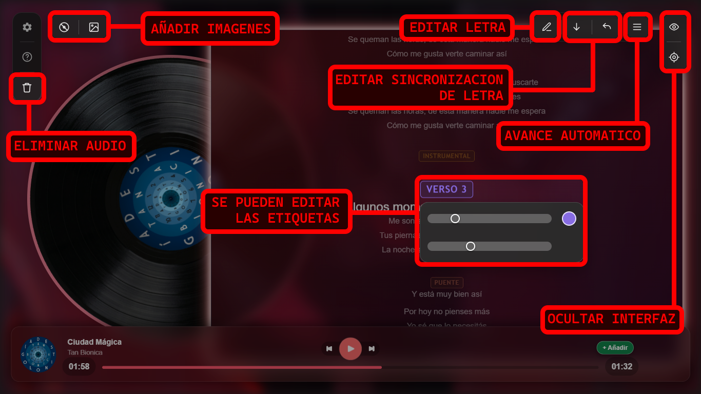
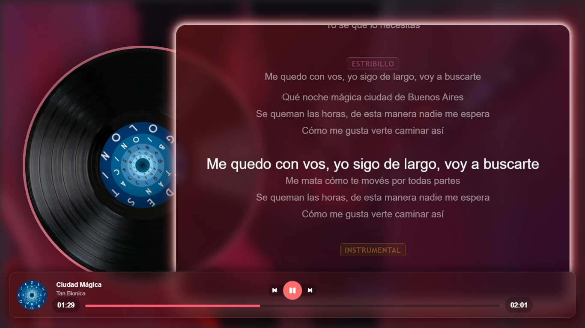
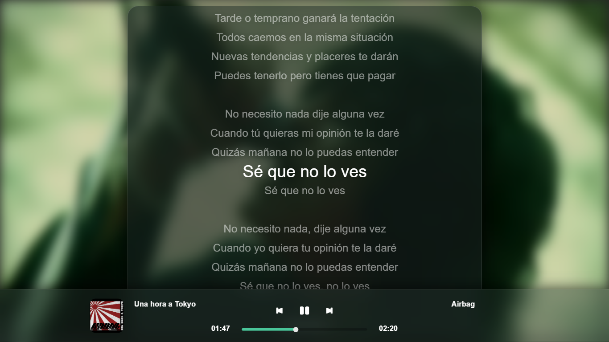
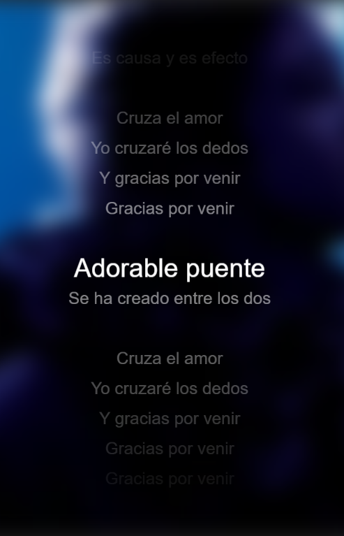

   

# RecK v1.0 - Full Release

Esta actualización presenta la primera versión completa de RecK. Aunque incluye las funcionalidades principales de la aplicación, no representa la versión final del proyecto, que continuará evolucionando con futuras mejoras y nuevas características.

## Descripción general

RecK es una aplicación de reproducción y visualización musical diseñada para crear videos que presentan canciones mediante una interfaz inspirada en reproductores modernos, como Spotify y Apple Music.

A diferencia de un reproductor convencional, cuyo objetivo principal es escuchar música, RecK está orientado a la creación de contenido audiovisual. Su propósito es permitir la presentación de canciones acompañadas de sus letras, con una interfaz visual personalizable que puede adaptarse a diferentes estilos y necesidades creativas.

## Características principales

- **Visualización de letras sincronizadas:** presenta la letra de una canción dentro de una interfaz inspirada en los reproductores musicales modernos.
- **Personalización avanzada:** permite modificar colores, tamaños y otros elementos visuales para adaptar la apariencia del reproductor.
- **Integración de imágenes:** permite incorporar imágenes como parte de la composición visual.
- **Control de la apariencia:** ofrece flexibilidad para construir diferentes diseños y estilos de presentación.
- **Orientación audiovisual:** está concebido para crear videos centrados en la experiencia visual de la música y sus letras.

## Origen del proyecto

RecK surgió de una necesidad concreta: crear un video que mostrara la letra de una canción mediante una interfaz similar a la de un reproductor musical. La idea tomó inspiración de una creación previa con un concepto similar, pero planteó una alternativa con mayor desarrollo visual, personalización y posibilidades creativas.

El proyecto evolucionó desde esa idea inicial hasta convertirse en una herramienta diseñada para ofrecer un control mucho más amplio sobre la presentación de la música.

```Versión: v1.0 - Primera versión completa.```
